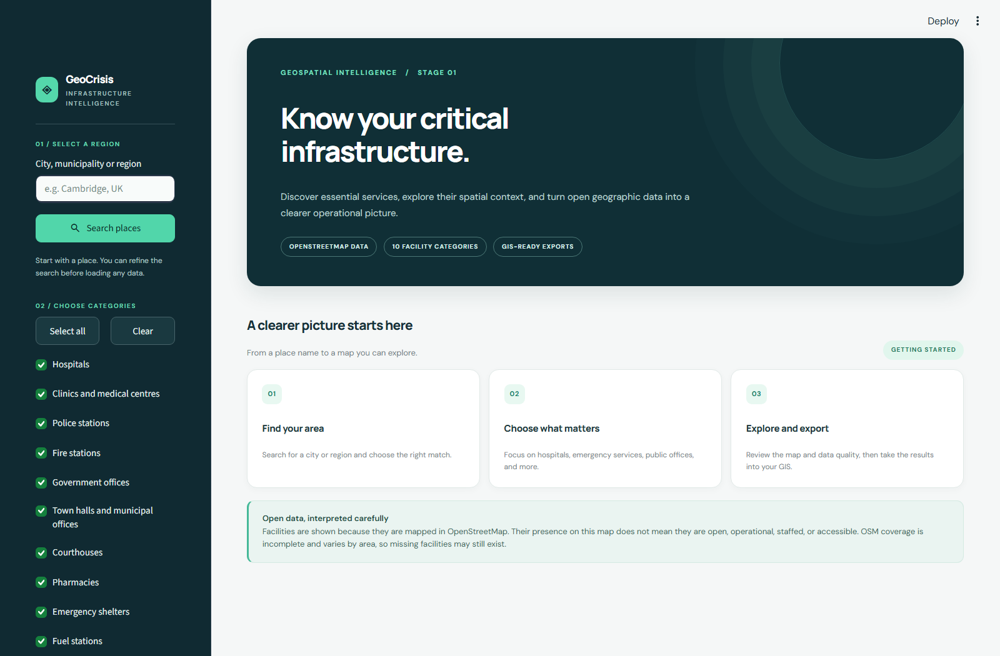

# 🌍 GeoCrisis Agent

**Explore essential infrastructure with open geospatial data.**

GeoCrisis finds facilities such as hospitals, clinics, police and fire stations,
public offices, pharmacies, shelters, and fuel stations in a city or region.
Explore them on an interactive map, review the data, and export the results for
your next project.



<details>
<summary>🎞️ View the application tour</summary>


[Getting started](docs/images/01-welcome.png) · [Map and insights](docs/images/02-map.png) · [Facility table](docs/images/03-table.png)

The map and table screenshots use **synthetic example facilities**. The map
background is based on OpenStreetMap.

</details>

## ✨ What you can do

- 🔎 Search for a city, municipality, or region and choose a matching place.
- 🏥 Select the types of facilities you want to explore.
- 🗺️ Inspect mapped facilities, category counts, and a searchable table.
- 📋 Review data-quality notes, such as missing names and possible duplicates.
- 📥 Download results as **CSV**, **GeoJSON**, or **JSON**.

## 🚀 Get started

You need **Python 3.11 or newer**. In the project folder, create a virtual
environment and install the dependencies:

```bash
python -m venv .venv
source .venv/bin/activate        # WSL, Linux, or macOS
pip install -r requirements.txt
```

On Windows PowerShell, activate the environment with
`.venv\Scripts\Activate.ps1` instead of the `source` command.

Start the English app:

```bash
streamlit run app_en.py
```

Open [http://localhost:8501](http://localhost:8501) in your browser. The Persian
version is also available with `streamlit run app.py`.

For regular use of the public map services, set `GEOCRISIS_CONTACT` to an email
address or project URL. In WSL, Linux, or macOS, for example:

```bash
export GEOCRISIS_CONTACT="you@example.org"
streamlit run app_en.py
```

## 🧭 Using the app

1. Enter a place in the sidebar and select the correct search result.
2. Choose the facility categories, then select **Find facilities**.
3. Explore map layers, filter the table, and check the **Data quality** tab.
4. Download the results from the sidebar in your preferred format.

Search results are cached for up to 24 hours and facility results for up to
6 hours. Use **Fetch fresh data** to request updated facility data. If a public
service is busy or unavailable, try again later or choose a smaller region.

## ⚠️ Good to know

- Facilities appear because they are mapped in OpenStreetMap. Their presence
  **does not confirm that they are open, operational, staffed, or accessible**.
  Coverage can be incomplete or out of date.
- If an administrative boundary is unavailable, results use a bounding box and
  may include nearby places outside the selected region.
- Markers for mapped areas may show an approximate center rather than an
  entrance. Possible duplicates are flagged for review, not automatically
  removed.
- OpenStreetMap shelter records can include bus-stop or weather shelters; check
  their details before treating them as emergency shelters.
- This version focuses on finding and mapping facilities. Routing, scenario
  analysis, and the LLM agent are not yet included.

## 🧪 Tests

Run `python -m pytest` from the project folder. The tests run offline.

---

🗺️ Data © [OpenStreetMap contributors](https://www.openstreetmap.org/copyright),
available under the Open Database License. Please follow the
[OpenStreetMap tile usage policy](https://operations.osmfoundation.org/policies/tiles/)
when using the default map tiles.
