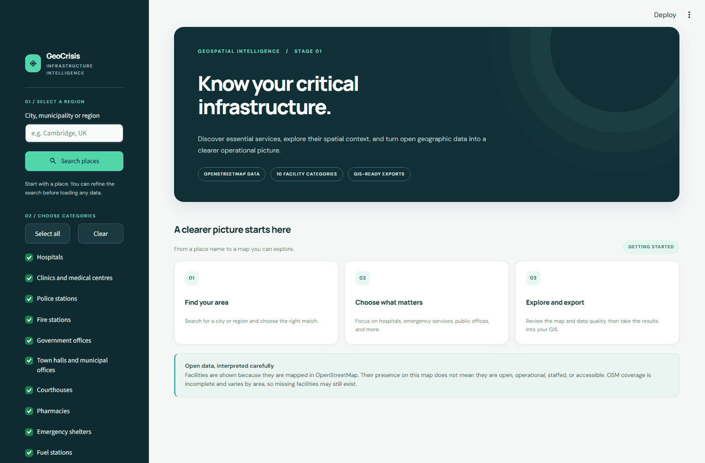

# GeoCrisis Agent

### Geospatial intelligence for essential infrastructure

A Streamlit application that finds essential civilian and public-service
facilities in a city or region using OpenStreetMap (OSM), shows them on an
interactive map, and exports them as CSV, GeoJSON and JSON for later routing
and crisis-management stages.

> **Data caveat.** Facilities appear because they are *mapped in OSM*. The app
> never claims that a facility is open, operational or accessible. OSM coverage
> is incomplete and varies by area.

This stage covers facility discovery, extraction, validation and mapping only.
Routing, scenario analysis and the LLM agent are out of scope.

## Interface tour



**Explore the slides:** [01 · Getting started](docs/images/01-welcome.png) ·
[02 · Map and insights](docs/images/02-map.png) ·
[03 · Facility table](docs/images/03-table.png)

The slides show the running English interface with **synthetic demonstration
records**; they are not actual facilities. Map data ©
[OpenStreetMap contributors](https://www.openstreetmap.org/copyright).

## Installation

Requires Python 3.11 or newer.

```bash
python -m venv .venv
.venv\Scripts\activate          # Windows
# source .venv/bin/activate     # Linux / macOS
pip install -r requirements.txt
```

## Running

```bash
# English interface
streamlit run app_en.py

# Persian interface (alternative)
streamlit run app.py
```

Streamlit opens the selected interface at http://localhost:8501. Both use the
same search, facility processing, map, and export services.

## Tests

```bash
python -m pytest
```

The tests run offline. They mock the HTTP layer and do not contact any public
service.

## Workflow

1. **Region**: enter a city, municipality or region and click *Search*
   (Nominatim). If several places match, choose the correct one. The sidebar
   tells you whether a boundary polygon is available.
2. **Categories**: all ten categories are selected by default.
3. **Load Facilities**: queries Overpass for nodes, ways and relations in the
   region's bounding box, then
   - normalizes the tags into display categories (original tags are kept in `raw_tags`),
   - drops records with missing or invalid coordinates,
   - removes repeated OSM elements (same type and ID),
   - clips the results to the administrative boundary, or to the bounding box
     when no boundary exists (with a warning),
   - flags unnamed records (`missing_name`) and same-name, same-category
     records within 100 m (`possible_duplicate:<type>/<id>`) without removing them.
4. **Inspect**: open the map with one toggleable layer per category, the
   counts per category, the searchable table and the processing details,
   including the exact Overpass query.
5. **Export**: download CSV, GeoJSON or JSON from the sidebar.

## User interfaces

- **English:** A left-to-right workspace with an onboarding guide, region and
  category controls, summary cards, an interactive map, a searchable facility
  table, data-quality details and CSV/GeoJSON/JSON exports. Map layers, popups
  and fullscreen controls are in English.
- **Persian:** The original right-to-left workspace remains available, with
  B Nazanin text, Persian digits and Jalali timestamps in Tehran time. Its map
  controls and popups remain in Persian.

The interfaces share the same processing pipeline and export formats. Facility
names and other original OSM tags are kept as supplied by OpenStreetMap.

## Facility categories

| Category | OSM tags |
|---|---|
| Hospitals | `amenity=hospital` |
| Clinics and medical centres | `amenity=clinic`, `amenity=doctors` |
| Police stations | `amenity=police` |
| Fire stations | `amenity=fire_station` |
| Government offices | `office=government` |
| Town halls and municipal offices | `amenity=townhall` |
| Courthouses | `amenity=courthouse` |
| Pharmacies | `amenity=pharmacy` |
| Emergency shelters | `amenity=shelter` |
| Fuel stations | `amenity=fuel` |

Categories are defined in `config.CATEGORIES`. When a category is added
there, the Overpass query, classification, map layer and exports pick it up
automatically. If an element has both an `amenity` and an `office` tag, the
`amenity` tag decides the category (`config.TAG_KEY_PRIORITY`).

**Shelters:** in OSM, `amenity=shelter` also covers bus-stop, picnic and
weather shelters. Every shelter record gets a `shelter_type:<value>` flag, and
clearly non-emergency types are also flagged `likely_not_emergency_shelter`.

## Record format

```json
{
  "osm_type": "way",
  "osm_id": 123456,
  "source_id": "way/123456",
  "name": "Example Hospital",
  "category": "hospital",
  "category_label": "Hospitals",
  "latitude": 52.52,
  "longitude": 13.405,
  "address": null,
  "operator": null,
  "phone": null,
  "website": null,
  "raw_tags": {"amenity": "hospital", "name": "Example Hospital"},
  "location_precision": "osm_way_center",
  "source": "OpenStreetMap",
  "retrieved_at": "2026-10-19T10:00:00+00:00",
  "quality_flags": [],
  "osm_url": "https://www.openstreetmap.org/way/123456"
}
```

`location_precision` is one of the following:
- `osm_node`: the mapped point.
- `osm_way_center` or `osm_relation_center`: the centre of the mapped area.
  This is an approximate marker position, not a building entrance or access point.

The JSON and GeoJSON exports also carry a `metadata` block with the source,
ODbL attribution, retrieval time, region, spatial filter and the
"not verified" status disclaimer.

## Configuration

Every endpoint and limit can be set with an environment variable (see `config.py`):

| Variable | Default | Purpose |
|---|---|---|
| `GEOCRISIS_CONTACT` | *(empty)* | Your e-mail or project URL. It is added to the User-Agent and, if it is an e-mail address, sent to Nominatim. **Set this for any real use.** |
| `GEOCRISIS_USER_AGENT` | `GeoCrisisAgent/0.1.0 (...)` | Full User-Agent override |
| `GEOCRISIS_NOMINATIM_LANGUAGE` | `fa,en` (Persian), `en` (English) | Language of region names returned by Nominatim |
| `GEOCRISIS_NOMINATIM_URL` | `https://nominatim.openstreetmap.org/search` | Geocoder endpoint |
| `GEOCRISIS_OVERPASS_URLS` | `https://overpass-api.de/api/interpreter,https://overpass.private.coffee/api/interpreter,https://maps.mail.ru/osm/tools/overpass/api/interpreter` | Comma-separated Overpass endpoints, tried in order. The next one is used only after a connection error, a client timeout or HTTP 502/503/504; a bad query (400), rate limiting (429) or an "out of memory" remark is reported at once. The endpoint that answered is shown in the app and written to the exports as `source_endpoint`. |
| `GEOCRISIS_OVERPASS_URL` | *(unset)* | Single Overpass endpoint, no fallback. Ignored when `GEOCRISIS_OVERPASS_URLS` is set |
| `GEOCRISIS_OVERPASS_QUERY_TIMEOUT` | `90` | Server-side query timeout (s) |
| `GEOCRISIS_MAX_QUERY_AREA_KM2` | `25000` | Larger bounding boxes are refused before any request is sent |
| `GEOCRISIS_HTTP_MAX_RETRIES` | `1` | Extra attempts per endpoint after HTTP 429/502/503/504 (one Overpass query sends at most endpoints × (1 + retries) requests) |
| `GEOCRISIS_TILE_URL` / `GEOCRISIS_TILE_ATTRIBUTION` / `GEOCRISIS_TILE_NAME` | OSM standard tiles | Map tile provider |
| `GEOCRISIS_GEOCODE_CACHE_TTL` / `GEOCRISIS_FACILITY_CACHE_TTL` | `86400` / `21600` | Cache lifetimes (s) |

Example (PowerShell):

```powershell
$env:GEOCRISIS_CONTACT = "you@example.org"
streamlit run app.py
```

## Responsible use of public OSM services

- **Nominatim:** requests are made only when you click *Search*, never as
  autocomplete. They are throttled to at most one per second, carry an
  identifying User-Agent, and are cached for 24 hours.
- **Overpass:** requests are made only when you click *Load* or *Refresh*.
  Results are cached for 6 hours, and *Fetch fresh data* bypasses the cache.
  The app retries at most once, honours `Retry-After`, and refuses oversized
  areas up front.
- **Tiles:** the default OSM tile server is suitable only for light
  interactive use under its
  [tile usage policy](https://operations.osmfoundation.org/policies/tiles/).
  Configure another provider for heavier use.
- When a request fails, the app shows the reason (timeout, rate limit, service
  unavailable, unexpected response). It never returns a silently empty dataset.
  An Overpass response that is truncated by a server-side timeout is treated as
  an error.

Data © OpenStreetMap contributors, available under the
[Open Database License](https://www.openstreetmap.org/copyright).

## Project structure

```text
app.py                          Streamlit UI (Persian, RTL)
app_en.py                       Streamlit UI (English, LTR)
.streamlit/config.toml          Shared theme and static font serving
static/fonts/                   B Nazanin font files served to the browser
ui/theme.py                     RTL layout and design-rule CSS
ui/en_theme.py                  English workspace styling
ui/components.py                Header, help boxes, status cards, bar list
ui/i18n_fa.py                   Persian texts and translated messages
ui/persian.py                   Persian digits and Jalali dates
config.py                       Endpoints, limits, categories, tiles
models/facility.py              Facility record
models/region.py                Region and bounding box
services/http_client.py         Headers, bounded retries, typed errors
services/region_search.py       Nominatim search + boundary parsing
services/overpass_client.py     Overpass QL builder and client
services/facility_service.py    End-to-end pipeline (UI-independent)
processing/normalize_facilities.py
processing/validate_facilities.py
processing/region_filter.py
visualization/facility_map.py   Localized Folium map, layers, popups
docs/images/                    Screenshots and README slideshow
exports/export_facilities.py    CSV / GeoJSON / JSON
tests/                          Offline pytest suite
```

Use `FacilityService` to run the pipeline without the UI:

```python
from services.region_search import NominatimClient
from services.facility_service import FacilityService

region = NominatimClient().search("Heidelberg, Germany")[0]
result = FacilityService().load(region, ["hospital", "fire_station"])
print(result.category_counts(), result.warnings)
```

## Known limitations

- The data is only as complete and current as OSM in the selected area.
- ID-based deduplication removes only repeats of the same OSM element. A
  facility mapped as both a point and a building outline can still appear
  twice. Same-name pairs are flagged, but unnamed duplicates cannot be detected.
- Boundaries come from Nominatim and are slightly simplified
  (`GEOCRISIS_NOMINATIM_POLYGON_THRESHOLD`). Facilities very close to the
  border may be classified differently than with the full-resolution boundary.
- Bounding boxes that cross the antimeridian are not supported.
